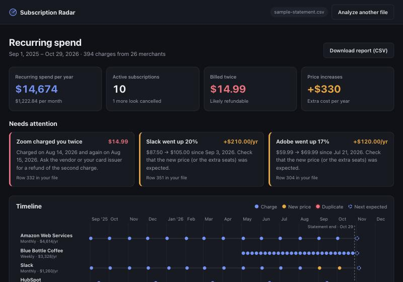

# Subscription Radar

Upload a card or bank statement (CSV) and see every subscription and recurring bill on it: what it costs per year, when it renews next, which ones **got more expensive**, which ones were **billed twice**, and which ones **look cancelled**.

Built for the finance person at a small company who gets a 400-line card statement every month and has no time to work out which SaaS tools are quietly renewing.



- **Backend:** Go, standard library only (no third-party modules).
- **Frontend:** React and TypeScript on Vite; charts are hand-drawn SVG.
- **No AI and no database.** Detection is rule-based and explainable, and files are analysed in memory and never stored.

## Run it

Requirements: **Go 1.22+** and **Node 20+**.

```bash
make run          # builds the UI, then serves everything on http://localhost:8080
```

Click **Try the demo statement**, or drop your own CSV.

[`examples/simple-statement.csv`](examples/simple-statement.csv) is a small file to try: three months, amounts in dollars, three subscriptions (Netflix, Spotify, Google Workspace) mixed in with everyday spending.

[`examples/subscriptions-with-alerts.csv`](examples/subscriptions-with-alerts.csv) has six months of data and triggers every alert type: two duplicate charges (Zoom, Spotify), two price increases (Adobe Creative Cloud from $54.99 to $89.99, GitHub from $21 to $25) and a Dropbox plan that looks cancelled.

For development with hot reload, use two terminals:

```bash
make api          # Go API on :8080
make web          # Vite dev server on :5173 (proxies /api to :8080)
```

Other commands:

```bash
make test         # go vet + go test -race ./... + TypeScript type-check
make sample       # writes the demo statement to ./sample-statement.csv
```

Without `make`:

```bash
cd frontend && npm ci && npm run build
cd ../backend && go run ./cmd/server -static ../frontend/dist
```

## API

| Method | Path | Description |
|---|---|---|
| `POST` | `/api/analyze` | Analyse a statement. Send it either as a multipart `file` field or as a raw CSV body. |
| `GET` | `/api/sample` | The demo statement as CSV. |
| `GET` | `/api/health` | Liveness check. |

```bash
curl -s localhost:8080/api/sample | curl -s --data-binary @- localhost:8080/api/analyze | jq '.analysis.totals'
```

Error responses:

- `422`: the file is not a statement (for example, required columns are missing). The message is written for the user.
- `413`: the file is larger than 5 MB.

Money is serialised as numbers in major units (`12.99`). Dates use the `YYYY-MM-DD` format.

## How it works

```
CSV ──► statement.Parse ──► merchant.Normalize ──► recurring.Analyze ──► JSON ──► React UI
        (format detection)   (grouping key)         (cadence, alerts)
```

**1. Reading any export** (`backend/internal/statement`). Bank exports disagree on almost everything, so the parser detects each convention from the data itself:

- **Delimiter:** comma, semicolon or tab.
- **Header language:** English, Portuguese or Spanish aliases.
- **Date order:** it looks at the whole column. A first part above 12 means DD/MM.
- **Number format:** `1,234.56` vs `1.234,56`, `(12.99)` for negatives, and currency symbols.
- **Sign convention:** banks show spending as negative and card issuers show it as positive. The majority sign decides which applies.

Every assumption is returned and shown under "How we read your file". Unreadable rows become warnings that include the row number.

**2. Finding the merchant** (`backend/internal/merchant`). `SLACK*T0A1B2C3`, `PAYPAL *SPOTIFY`, `ZOOM.US 888-799-9666 CA` and `GITHUB, INC. GITHUB.COM CA` become `Slack`, `Spotify`, `Zoom` and `GitHub`. A short list of readable rules does this:

- drop reference ids after `*`;
- unwrap payment processors such as PayPal and Square;
- keep the product name for platforms (`Google Workspace` vs `Google Cloud`);
- remove phone numbers, domains, legal suffixes and trailing state or country codes.

**3. Detecting recurrence** (`backend/internal/recurring`). For each merchant and currency:

| Step | Rule | Why |
|---|---|---|
| Duplicates | Same amount (±1%) within 3 days is set aside as double billing | Weekly plans are never closer than 6 days apart |
| Cadence | Median gap matches weekly (7±1), biweekly (14±2), monthly (30.4±4), quarterly (91±8) or yearly (365±12) days | The median survives one late or missed charge |
| Regularity | At least 75% of gaps fit the cadence | One missed month in a year is still a subscription |
| Minimum count | 3 charges (4 for weekly, 2 for yearly) | Two monthly charges can be a coincidence |
| Amounts | Spread (median absolute deviation / median) ≤ 2% means fixed; ≤ 25% means usage-based; above that it is not a bill | Weekly grocery runs are regular but are not subscriptions |
| Price increase | A stable old price followed by a run at a price at least 5% higher | Below 5% it is FX or tax noise; usage-based bills never trigger it |
| Status | No charge for 1.5 cycles plus tolerance means "looks cancelled" | Measured from the last date in the file, so results are reproducible |

The money logic uses integer cents and calendar dates in UTC, with no floats and no time-zone drift. Next charges are projected on the same calendar day; for example, Jan 31 is followed by Feb 28.

## Tests

`make test` runs 36 Go test functions (about 60 table cases, plus 50 seeded end-to-end runs) with the race detector, and type-checks the UI.

- **End to end, with precision and recall.** `internal/sample` generates a realistic, seeded 14-month corporate card statement with a known answer key. The statement has 11 planted subscriptions across all cadences:
  - a usage-based AWS bill;
  - a cancelled Dropbox;
  - one duplicate charge;
  - two price increases;
  - about 380 noise transactions designed to look recurring (monthly-ish Staples runs, weekly-ish fuel, Uber).

  The test runs **50 different seeds** through the full pipeline (CSV → parser → detector) and requires the exact answer key every time: no misses and no false positives.
- **Unit tests** cover parsing (formats, locales, bad rows), merchant normalisation, every detection rule and its counter-cases, and the HTTP layer (multipart upload, raw upload, size limit, error codes, static file serving).

## Project layout

```
backend/
  cmd/server        HTTP server (also serves the built UI with -static)
  cmd/gensample     writes a synthetic statement
  internal/ledger     Date and Cents types
  internal/statement  CSV → transactions
  internal/merchant   description → merchant key
  internal/recurring  detection, alerts, totals
  internal/sample     seeded statement generator + answer key
  internal/api        HTTP handlers
frontend/src
  api/              typed client + response types
  components/       Upload, Summary, AlertList, Timeline (SVG), SeriesTable, ParseNotes
```

## Known limitations

- A new subscription needs a third charge before it shows up. Yearly plans need a second charge.
- The same vendor billed under very different descriptors (for example `AMZN` vs `AMAZON`) is treated as two merchants.
- Regular habits with moderately varying amounts can look like usage-based bills, for example lunch at the same place on the same day every month. The 25% spread threshold is the knob that controls this.
- Amounts are assumed to have 2 decimal places, which does not hold for currencies such as CLP or JPY.
